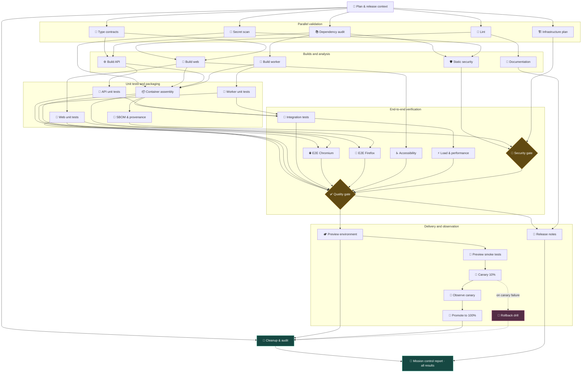

# Pipeline Observatory

An extensive GitHub Actions pipeline that runs for approximately **5 minutes**: **32 separate jobs**, parallel branches, builds for three services, browser checks, shared gates, a canary deployment, and an emergency rollback. Every process appears in the Actions graph and streams live logs.

This is an orchestration demo. Builds, tests, scans, deployments, and their metrics are **simulated**; dependencies, job execution, statuses, execution times, and artifacts are real. No secrets or external infrastructure are required, and production is unaffected.

## Run in GitHub

1. Commit and push the files to GitHub; the workflow must be present on the default branch for manual runs.
2. Open **Actions → Pipeline Observatory · 5 minute demo → Run workflow**.
3. Keep `duration_seconds: 300` and `fail_at: none`, then run the workflow.

The pipeline also runs on pushes and pull requests targeting `main`. A new run for the same branch cancels the previous one.

| Parameter | Values | Purpose |
| --- | --- | --- |
| `duration_seconds` | `300`, `120`, `30` | Target duration; defaults to 300 seconds |
| `fail_at` | `none`, `unit_api`, `security_gate`, `e2e_chromium`, `canary` | Node to fail intentionally; defaults to no failures |

A shared timer synchronizes stages relative to the start of `plan`. GitHub queues, runner concurrency limits, and machine startup can extend the total duration beyond five minutes. The 30-second mode shortens the simulation while GitHub Actions overhead still applies.

## What to watch

- **Workflow graph:** broad branching after `plan`, parallel builds and checks, shared gates, and a sequential release chain.
- **Each job:** three named phases—preparation, processing with live progress, and result collection—followed by an artifact upload. Logs include timestamps, groups, and progress messages.
- **Summary:** a report for each job and an overall summary with statuses, durations, and a link to the run result.
- **Artifacts → `mission-control-<run_id>-<attempt>`:** download and extract the archive, then open `report.html` in a browser. This is a standalone dark dashboard with a DAG, a timeline, and process details; the archive also includes `report.json`, `report.md`, and the source job reports.

Artifacts are retained for 7 days. The HTML dashboard shows a completed run; live execution is visible directly in Actions.

## Process graph



For readability, only two incoming edges are shown for `report`: in the actual workflow, it depends on **all 31 preceding jobs**. Dashed lines indicate the conditional recovery branch.

## Demonstrate a failure

Select `fail_at: canary` to see a red canary job, skipped `observe` and `promote` jobs, followed by a successful `rollback`. Use `unit_api`, `security_gate`, or `e2e_chromium` for an earlier failure: dependent branches will be skipped while independent branches continue.

`cleanup` and the final report run after failures unless the workflow is canceled. The report preserves the actual `failure` and `skipped` statuses; publishing the report successfully does not make a failed workflow successful. On a normal successful run, `rollback` is skipped as expected.

## Local runs and customization

Only Python and its standard library are required; no packages need to be installed. From the repository root:

```console
python scripts/demo_pipeline.py local --duration 3
python scripts/demo_pipeline.py local --duration 3 --fail-at canary
```

The second command intentionally exits with code `1`. Results are written to `reports/`: open `reports/report.html`. To use a different directory, add `--reports-dir <path>`. Local simulation lets you quickly check the graph, logs, failure handling, and report generation without waiting for a GitHub runner.

The topology source is [`demo/pipeline.json`](demo/pipeline.json): names, `needs` dependencies, three tasks per process, demo metrics, and target `offset` timestamps. After making changes, regenerate the workflow and check that it is up to date:

```console
python scripts/generate_workflow.py
python scripts/generate_workflow.py --check
python -m unittest discover -s tests -v
```

The initial `plan` job also checks that the workflow is up to date and runs these tests: a successful graph, all four failure scenarios, rollback, timer handoff between steps, and artifact collection.

The generated [`pipeline-demo.yml`](.github/workflows/pipeline-demo.yml) defines the actual GitHub Actions dependencies; [`demo-stage`](.github/actions/demo-stage/action.yml) provides consistent phases for each process, and [`demo_pipeline.py`](scripts/demo_pipeline.py) handles simulation and reporting.
